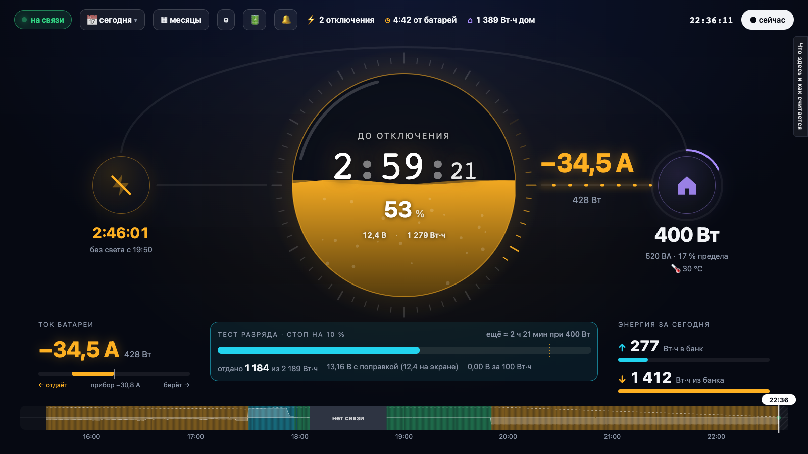

# inverter-monitor

A home backup-power monitor for a 12 V off-grid inverter with a LiFePO4 bank: it reads the inverter locally through
its Wi-Fi dongle every 5 seconds, keeps every reading, and shows in a dark web admin on the home LAN how much charge
is left, how long it will last, what happened on any day, and — behind a PIN — lets you change the inverter's
settings safely and set up Telegram notifications. It can also poll the DessMonitor cloud (the platform behind the
SmartESS / ESS SMART apps).

It answers one question honestly: **how much charge is left, and for how long.** The inverter's own percentage is a
voltage map, not a fuel gauge, so the bank is counted from energy in and out — and, once you run a discharge test,
from what your own bank measured.



## Hardware it was built and tested on

- **Inverter:** Volt Polska SINUS PRO ULTRA 3000 12/230 V (1500 W continuous / 3000 VA peak, 12 V, 100 A MPPT
  30–500 V, Wi-Fi with the ESS SMART app). It reports device type 0x3A00 and Modbus protocol 1.
- **Dongle:** the Eybond Wi-Fi datalogger that comes with it (SmartESS / DessMonitor cloud).
- **Bank:** 2 × Ritar R-LFP12.8V100AH-MINI (12.8 V 100 Ah LiFePO4) in parallel: 200 Ah, 2560 Wh nameplate.
- **Host:** an always-on Mac (macOS, LaunchAgents); Python 3 as shipped with macOS, Node ≥ 20.

### What else should work, and what is not tested

- **Should work:** inverters of the same family that speak Modbus RTU behind the same kind of Eybond dongle — the
  SMG / SMG-II register map (live data 201–234, settings 300–343; see `collector/README.md` and
  `admin/src/pages/settings/catalog.js`). Many 1–6 kW "hybrid solar inverters" are rebrands of this design (EASUN /
  ISolar SMG II, PowMr, Anenji and others). **Not tested** on any of them: check every reading against the
  inverter's own screen before you trust it, and do not write settings until you have.
- **Not supported:** inverters that only speak the Voltronic/Axpert PI30 ASCII protocol (the dongle relays it, but
  this code speaks Modbus only); other dataloggers (Solarman, ShineWiFi…); batteries other than 12 V LiFePO4 without
  editing the model's numbers (`admin/src/lib/admin/model.js`, `notifier/rules.py`).
- The admin's language is Russian; times are Kyiv's; the outage-schedule rule reads Ukrainian schedules
  (svitlo.live). Everything else is plain code you can change.

## Modes

| | what runs | what you get |
|---|---|---|
| **Cloud only** | `scripts/` from cron every 5 min | a log of the cloud's packets, `energy.py` estimates; needs a DessMonitor account |
| **Local dongle** | `collector/` (LaunchAgent) + `admin/` | every 5 s, no cloud needed, the admin |
| **Both** | all of the above | the collector reads alongside the cloud; the admin merges the two |
| **Read-only** (default) | — | nothing is ever written to the inverter |
| **Settings writing** | `writer/`, started by the admin | only after you set a PIN; see the safety notes |
| **Notifications** | `notifier/` (LaunchAgent, off until you switch it on) | Telegram messages: outages, levels, overload, heat, «won't last until the power is back»… |

## Install

```bash
git clone <this repository> inverter-monitor && cd inverter-monitor
cp config.example.json config.json && chmod 600 config.json   # then fill it in (below)
```

`config.json` (ignored by git) holds everything that belongs to your home:

- `dongle.ip`, `dongle.broadcast`: the dongle's address on your LAN (from your router's DHCP list) and the LAN's
  broadcast address.
- `admin.port`: the admin's port (8080 if unset).
- `inverter.*`: the model, and if you like your unit's serial / firmware, shown on the settings page.
- `cloud.*`: only for the cloud poller — the company key the DessMonitor web app sends, and your device's pn, sn,
  devcode, devaddr from the web app.
- `telegram.botEnv`, `telegram.chatId`: only for notifications — a file with `BOT_TOKEN=…` of a bot you created with
  @BotFather, and your own chat id with it.

Then:

```bash
collector/service.sh install                      # the local reader, every 5 s; data in data/dongle/
(cd admin && npm ci && npm run build) && admin/service.sh install   # the admin on http://<mac>.local:<port>/
admin/pin.sh set                                  # optional: allows changes (settings, bot); view-only without it
notifier/service.sh install                       # optional; or switch it on from the admin's Бот page
```

The cloud poller (optional): log in once in a real terminal, `python3 scripts/dess_login.py` (it stores only the
token, in `~/.config/dessmonitor/`), then add `*/5 * * * * <path>/scripts/poll.sh` to your crontab.

Checks (no inverter needed): `node admin/check.mjs`, `node admin/check_server.mjs`, `node admin/check_calibrate.mjs`,
`python3 writer/check_writer.py`, `python3 notifier/check_rules.py`, `python3 notifier/check_notify.py`.
`node admin/sandbox.mjs` runs the whole admin against a fake inverter.

## Writing settings: safety notes

Changing an inverter's settings can damage the battery or cut power to the house. This project is careful, but it is
**your** inverter:

- Nothing is written until you set a PIN, and every change needs it (only a scrypt hash is stored; 5 wrong PINs
  lock changes for 15 min, three locks in a row until `admin/pin.sh unlock` on the Mac itself).
- Only the registers in `writer/allowed.json`, within the manual's ranges, can be written. Settings marked grey
  (equalisation for LiFePO4, output mode, protection limits) never open; red ones need a 2-second hold.
- A write happens only when the inverter is on the line, on mains (never during an outage) and not charging hard.
- The writer reads all settings first (the way back), writes **one register at a time, reads it back and compares**;
  any refusal, timeout, mismatch or dropped link stops the job and puts back everything it touched. Every step is
  journaled, each change has «вернуть».
- The inverter's own rules from its manual (float ≤ C.V., AC charge ≤ total charge, ranges) are checked before
  anything is sent; the inverter may refuse more.
- **Status:** the whole path is tested against a simulated inverter (`writer/fake_inverter.py`). On a real unit,
  whether the dongle relays Modbus function 6 has not been confirmed yet: make your first write a harmless one
  (the screen's backlight, register 305) and watch it read back.
- LiFePO4: do not set charge voltages above your battery's specification, never enable equalisation, and keep the
  low-voltage cut-off above your BMS's protection voltage with a margin.

## Layout

    collector/   the local reader (read-only Modbus through the dongle), LaunchAgent
    writer/      the settings writer (separate program, started by the admin), a fake inverter, its checks
    admin/       the web admin (Vite + React, built to dist/), its server, PIN, checks, sandbox
    notifier/    Telegram notifications: rules, sender, schedule reader, checks
    scripts/     the DessMonitor cloud client, poller, energy estimates
    common/      config.json reader, LaunchAgent writer
    data/        everything measured and every local state (ignored by git)

Not affiliated with Volt Polska, Ritar, Eybond or DessMonitor. Register maps: the SMG-II map published in
[syssi/esphome-smg-ii](https://github.com/syssi/esphome-smg-ii) and the field list of
[oleks-p/ha-eybond-local](https://github.com/oleks-p/ha-eybond-local); program numbers and ranges from Volt Polska's
manual for SINUS PRO ULTRA 3000–7000.

## Licence

MIT — see [LICENSE](LICENSE). Use it at your own risk, above all the settings writing.

## Коротко українською

Монітор резервного живлення для 12-вольтового інвертора з LiFePO4: кожні 5 с читає інвертор через його Wi-Fi донгл
(локально, без хмари), зберігає всі показання і показує в темній адмінці в домашній мережі, скільки заряду лишилось і
на скільки вистачить. За PIN-кодом — безпечна зміна налаштувань інвертора (по одному регістру, з перевіркою і
відкатом) та сповіщення в Telegram. Зібрано й перевірено на Volt Polska SINUS PRO ULTRA 3000 12/230 В і 2 × Ritar
12,8 В 100 А·год; інші інвертори родини SMG / SMG-II з донглом Eybond мають працювати, але не перевірені. Усе своє
(адреси, ідентифікатори, чат) — у `config.json`, який не потрапляє в git. Інтерфейс — російською.
